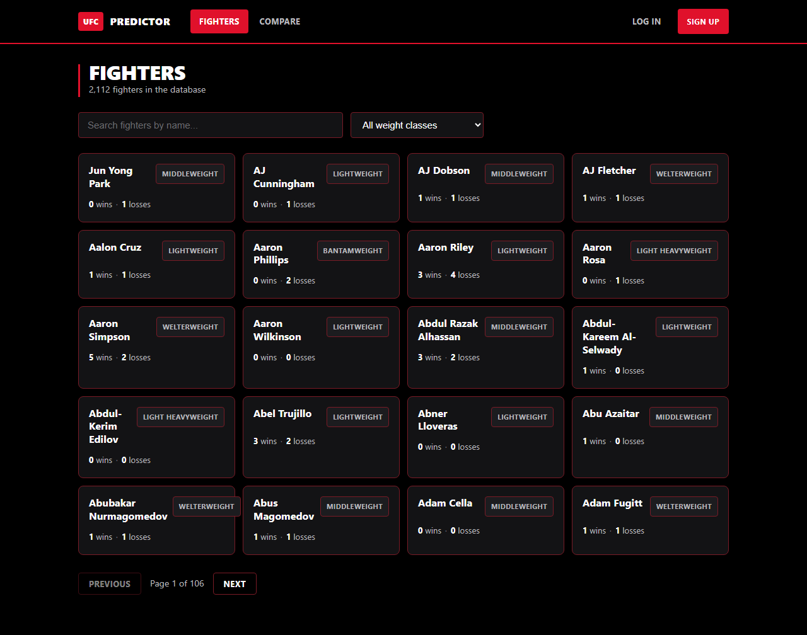
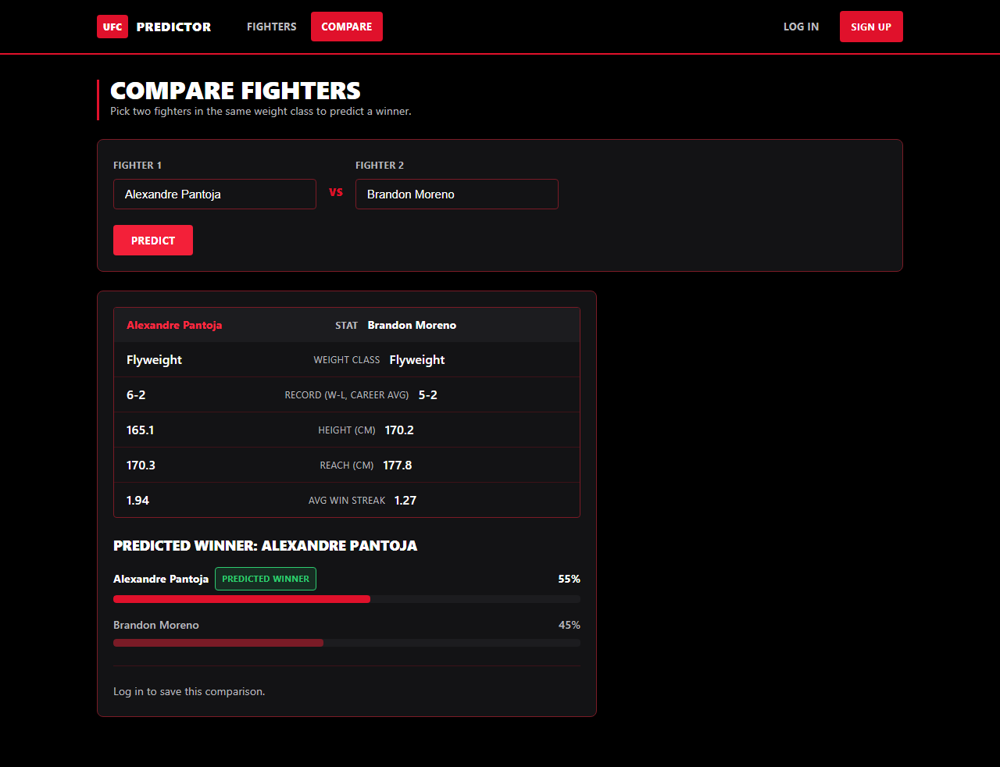
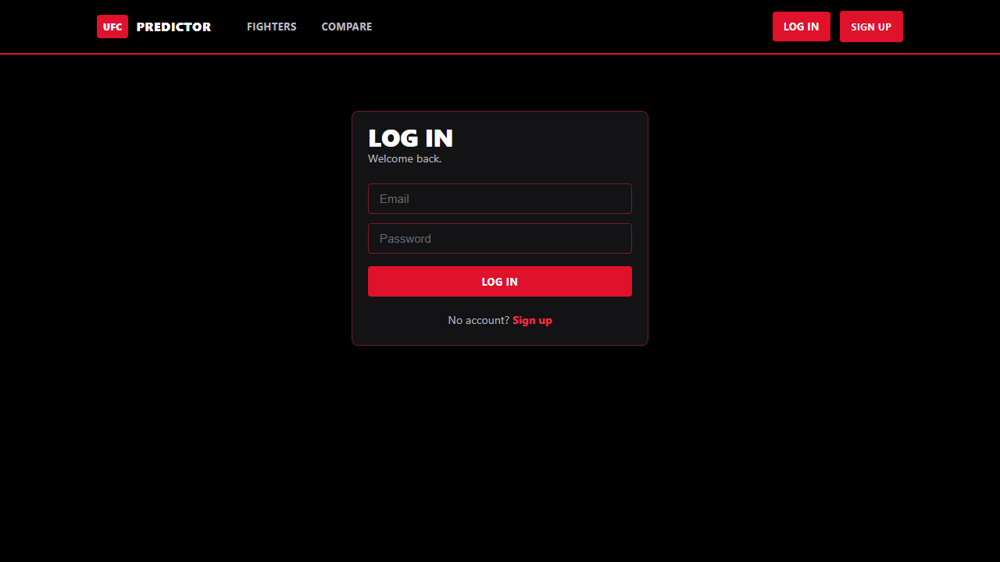

# FIGHTIQ — UFC Fight Outcome Predictor

A full-stack web app that predicts the outcome of a UFC matchup. Pick two fighters,
get a predicted winner with win probabilities, and save matchups to your account.

Built around a scikit-learn model trained on 6,528 historical UFC fights, served
through a FastAPI REST API backed by PostgreSQL, with a React frontend.



---

## Features

- **Fighter database** — 2,112 fighters with search, weight-class filtering, and pagination
- **Matchup prediction** — side-by-side stat comparison plus predicted winner and win probabilities
- **Authentication** — JWT-based signup and login with bcrypt-hashed passwords
- **Saved comparisons** — logged-in users can save, list, and delete matchups, scoped to their account

## Screenshots

**Comparison with prediction**



**Authentication**



---

## Tech stack

| Layer | Technology |
|---|---|
| Frontend | React 19, Vite, React Router, Axios |
| Backend | FastAPI, SQLAlchemy 2, Alembic, Pydantic |
| Database | PostgreSQL 16 |
| ML | scikit-learn (Logistic Regression), pandas |
| Auth | JWT (python-jose), bcrypt (passlib) |
| Infra | Docker Compose (local Postgres), Render, Vercel |

## Architecture

```
React SPA  ──── HTTP / JSON ────>  FastAPI  ──── SQL ────>  PostgreSQL
(Vercel)                          (Render)                  (Render)
                                      │
                                      └──> ufc_ml.pkl  (trained model, loaded once at startup)
```

The frontend holds no business logic. The API owns prediction, validation, and
auth; PostgreSQL persists fighters, users, and saved comparisons.

---

## The model

A logistic regression trained on 27 features per fight — betting odds and expected
value, current win/lose streaks, wins by KO / submission / decision type, and
physical attributes (height, reach, weight) for both fighters.

| Metric | Score |
|---|---|
| Accuracy | 0.662 |
| F1 | 0.738 |
| Precision | 0.683 |

Training lives in [`project.py`](project.py). The API loads the resulting pickle and
serves it — it never retrains.

**On interpreting these numbers:** betting odds are among the input features, and
odds already encode the market's own forecast. A meaningful share of the accuracy
therefore comes from reading the market rather than reasoning from fighter
attributes alone. The honest framing is "beats a coin flip on a genuinely noisy
problem," not "beats the bookmakers."

### Turning fight rows into fighter profiles

The source dataset is **fight-level**: each row is one Red-vs-Blue matchup with both
fighters' stats frozen at that point in time. There is no fighter table and no
fighter ID — only names repeated across rows.

[`seed_fighters.py`](backend/app/scripts/seed_fighters.py) reshapes this once at
setup: for each of the 2,112 unique fighters it collects every fight they appear in
(from either corner), averages their own stats, and takes their most recent fight
for point-in-time attributes like weight class and stance. The result is one row per
fighter, which the prediction endpoint reads directly instead of re-parsing a 2.9 MB
CSV on every request.

### Corner assignment

The model was trained with `Winner` encoded as Red = 1, Blue = 0, so every
prediction needs a Red and a Blue fighter. The corner is assigned by sorting the two
names alphabetically — arbitrary, but deterministic and consistent with how the
original app fed the model, so predictions stay reproducible.

---

## API

| Method | Endpoint | Auth | Description |
|---|---|---|---|
| `GET` | `/health` | — | Health check |
| `GET` | `/fighters` | — | List fighters (`search`, `weight_class`, `page`, `page_size`) |
| `GET` | `/fighters/{id}` | — | Single fighter |
| `POST` | `/predict` | — | Predict a matchup from two fighter IDs |
| `POST` | `/auth/signup` | — | Create an account |
| `POST` | `/auth/login` | — | Exchange credentials for a JWT |
| `GET` | `/auth/me` | ✅ | Current user |
| `POST` | `/comparisons` | ✅ | Save a matchup |
| `GET` | `/comparisons` | ✅ | List the current user's saved matchups |
| `DELETE` | `/comparisons/{id}` | ✅ | Delete one (403 if not the owner) |

Interactive docs are available at `/docs` when the server is running.

`/predict` returns `422` if the two fighters are the same or are in different weight
classes, since the model's input distribution assumes same-division matchups.

---

## Running locally

**Prerequisites:** Python 3.13, Node 20+, Docker Desktop

### Backend

```bash
cd backend
cp .env.example .env
```

Generate a real secret and put it in `.env` as `JWT_SECRET` — the app refuses to
start with the placeholder value:

```bash
python -c "import secrets; print(secrets.token_urlsafe(48))"
```

Then:

```bash
python -m venv .venv
.venv/Scripts/python.exe -m pip install -r requirements.txt   # Windows
docker compose up -d                                          # Postgres on :5432
.venv/Scripts/python.exe -m alembic upgrade head              # create tables
.venv/Scripts/python.exe -m app.scripts.seed_fighters         # load 2,112 fighters
.venv/Scripts/python.exe -m uvicorn app.main:app --port 8000
```

### Frontend

```bash
cd frontend
cp .env.example .env.local     # VITE_API_URL=http://localhost:8000
npm install
npm run dev                    # http://localhost:5173
```

> On Windows PowerShell, run each command on its own line — `&&` chaining is not
> supported.

---

## Project structure

```
backend/
  app/
    main.py                     FastAPI app, CORS, router mounting
    core/       config.py       settings + startup security validation
                security.py     password hashing, JWT encode/decode
    db/         models.py       Fighter, User, SavedComparison
                session.py      engine, session factory, get_db dependency
    schemas/                    Pydantic request/response contracts
    api/        deps.py         get_db, get_current_user
                routes/         predict, fighters, auth, comparisons
    services/   model_service.py       loads the pickle, builds feature vectors
                prediction_service.py  validation shared by /predict and /comparisons
    scripts/    seed_fighters.py       CSV -> fighters table
  alembic/                      schema migrations
frontend/
  src/
    api/                        axios client + endpoint modules
    context/AuthContext.jsx     auth state, token lifecycle
    components/                 FighterCard, FighterSelect, Spinner, ProtectedRoute
    pages/                      FighterList, Comparison, Login, Signup, SavedComparisons
legacy/                         original Streamlit prototype (superseded)
project.py                      model training script
render.yaml                     Render blueprint (API + Postgres)
```

---

## Engineering notes

**Precomputed fighter profiles.** The original prototype re-read and re-aggregated
the full CSV on every prediction. Moving that work into a one-time seed step turned
each prediction into two indexed primary-key lookups.

**A silent data bug in the prototype.** The original aggregation built columns named
`TempOdds` but looked them up as `Temp_Odds`. The lookup never matched, so it always
fell through to a default that averaged the raw column across every fight a fighter
appeared in — quietly blending opponents' stats into each fighter's averages for
anyone who had fought from both corners. The rewrite computes each fighter's own
stats. The bug is preserved in [`legacy/`](legacy/) with an explanation, so that
directory remains an accurate record of the original.

**Fail-fast on an insecure JWT secret.** `JWT_SECRET` previously fell back to a
placeholder committed in `.env.example`. Because a JWT's signature is the only proof
of authenticity, a publicly known secret means anyone can mint a valid token for any
account. The app now validates the secret at startup and refuses to boot on the
placeholder or anything under 32 characters.

**Expired-token handling.** Tokens expire after 60 minutes. Without explicit
handling the UI kept showing a logged-in state while every request failed. An axios
response interceptor now clears the session on a `401` — while ignoring `401`s from
the login endpoint itself, where it simply means a wrong password.

**Server-side prediction on save.** `POST /comparisons` re-runs the prediction on the
server rather than trusting a result supplied by the client, sharing one validated
code path with `/predict`.

---

## Deployment

The backend deploys to Render via the [`render.yaml`](render.yaml) blueprint, which
provisions the web service and PostgreSQL together, generates `JWT_SECRET`, runs
migrations, and seeds fighters on first boot. The frontend deploys to Vercel with
root directory `frontend` and `VITE_API_URL` pointed at the API.

After the frontend URL exists, set `CORS_ORIGINS` on the backend to that URL —
otherwise the browser blocks every request. [`frontend/vercel.json`](frontend/vercel.json)
contains the SPA rewrite rule so that deep links like `/compare` resolve on refresh
rather than 404ing.

---

## Roadmap

- Fighter detail pages (the `GET /fighters/{id}` endpoint exists but is unused)
- Display true career records rather than career averages
- Retrain with feature scaling so the optimizer converges
- Evaluate a variant without betting-odds features to isolate the signal coming
  from fighter attributes alone
